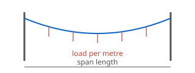

# hello-wasm

An example plugin: it shows how a plugin is built and how it ships its own
help page. This page is the plugin's **overview**, declared in its manifest:

```toml
[help]
overview = "docs/index.md"
```

The Plugin manager's **Help** button opens it (File › Plugins › Plugin
manager).

## What it computes

The total load of a distributed load over a span: the load per metre times
the span length.

| Input | Unit | Meaning |
|---|---|---|
| load per metre | N/m | the distributed load |
| span length | m | the horizontal distance between the structures |



## How a page is shown

A Markdown page like this one is rendered to a plain HTML page on this
computer and opened in the browser; an HTML page is opened as it is.
Pictures (such as the drawing above) are read from the plugin's folder.
Nothing is fetched from the internet.
